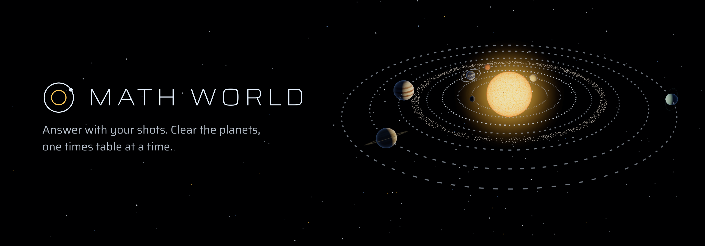
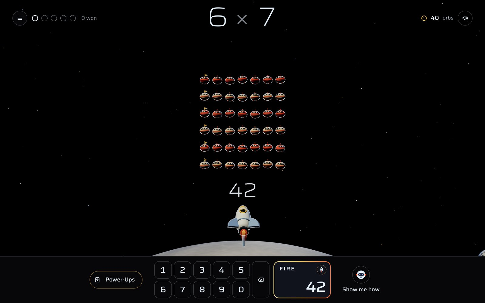
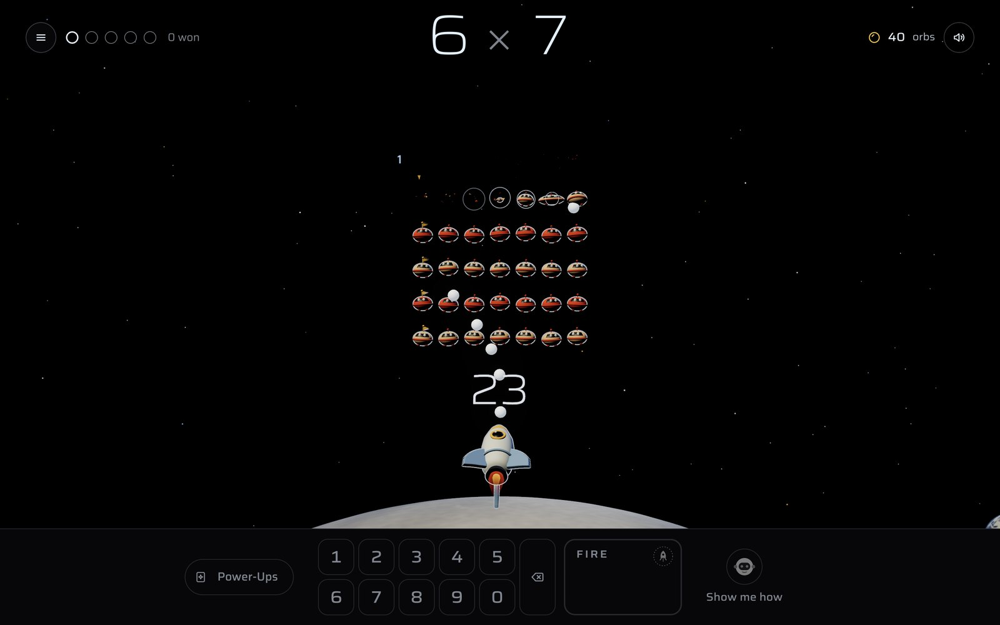
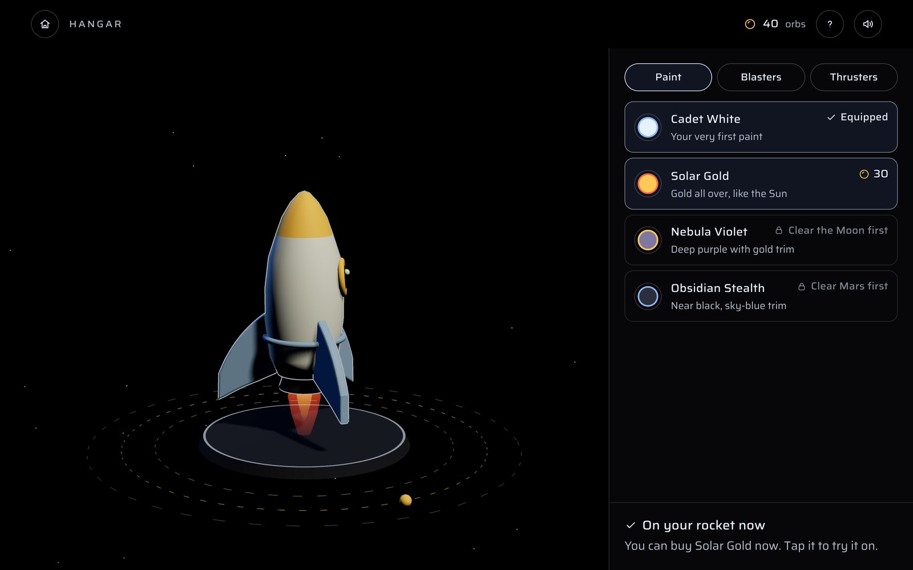
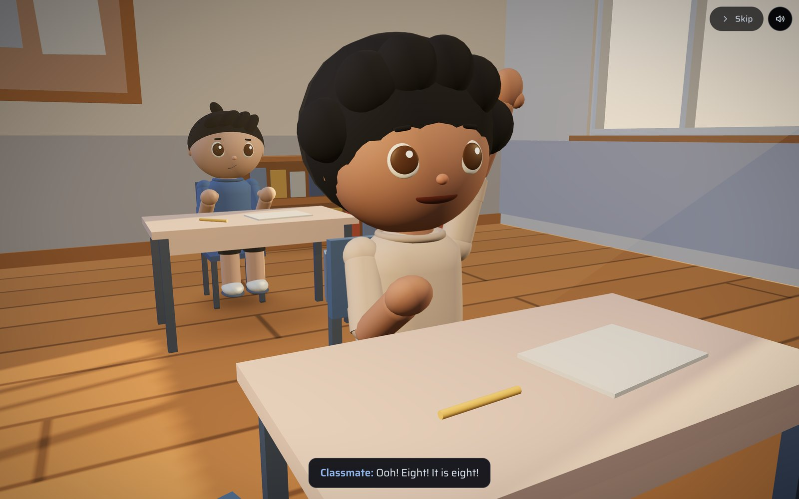
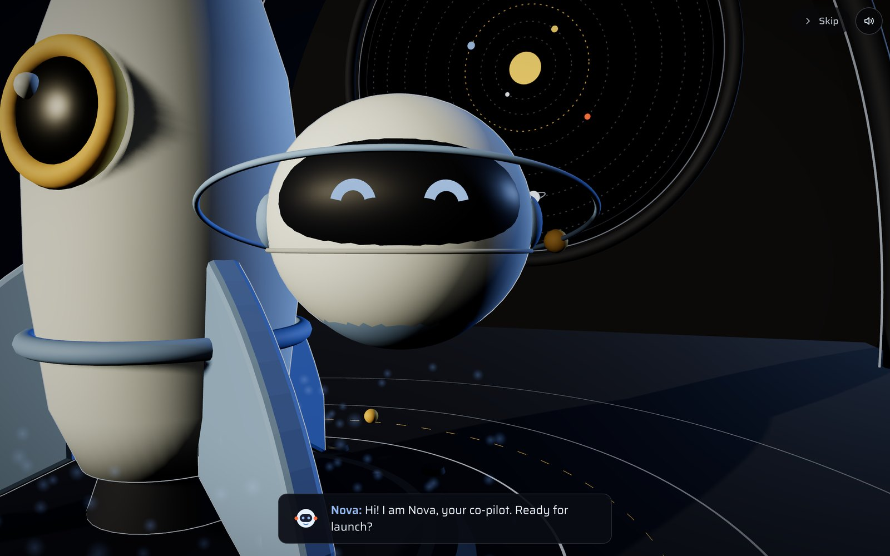

<p align="center">
  
</p>

# Math World

A space multiplication game where the answer is the action. A fleet flies in as `a` squads of `b` ships, drawn as a true array. You type how many ships there are and fire exactly that many plasma balls. Fire too few and the ships that are left fly on; fire too many and the extras fly past. The game levels itself from `0 × 0` up to multi-digit fleets, and every miss shows the child what to look at next.

It is for children from Grade 3 up, and for adults who do not want to be talked down to.

<p align="center">
  
</p>
<p align="center"><sub>Six squads of seven. The number you type is the number of plasma balls, on the rocket and on the Fire button.</sub></p>

<table>
  <tr>
    <td width="50%"><br><sub>Fire, and exactly that many plasma balls fly, squad by squad.</sub></td>
    <td width="50%"><br><sub>After a miss the game counts the squads with you, one at a time.</sub></td>
  </tr>
  <tr>
    <td width="50%"><br><sub>The Resting Bay: the next mission, and the times tables filling in.</sub></td>
    <td width="50%"><br><sub>The Star map, one planet at a time.</sub></td>
  </tr>
  <tr>
    <td width="50%"><br><sub>A first visit walks through each screen, one control at a time.</sub></td>
    <td width="50%"><br><sub>The Hangar: orbs earned by learning buy looks for the rocket.</sub></td>
  </tr>
</table>

<table>
  <tr>
    <td width="33%"><br><sub>The opening film starts on an ordinary Tuesday.</sub></td>
    <td width="33%"><br><sub>The cadet meets Nova, the co-pilot.</sub></td>
    <td width="33%"><br><sub>And it ends with a launch.</sub></td>
  </tr>
</table>

<p align="center">
  
</p>
<p align="center"><sub>On a phone: the battle, the Power-Ups list, the Star map and the Resting Bay.</sub></p>

## What a new cadet plays

1. **Title and sign-up (`/`).** One button, then a name and a colour.
2. **The opening film (`/intro`).** A classroom, two quick questions, a knock at the door, and the cadet is called up by name. It ends on Launch. Skip is always there.
3. **The first shot.** Three steps, one idea each: count the ships, type how many, press Fire.
4. **Earth (`/play/earth`).** Times 0 and times 1. Clearing a planet opens the next one.
5. **The Resting Bay (`/bay`).** The next mission and one Launch button, the cadet's ten times tables filling in, and the way to the other places.
6. **The Star map (`/map`).** One planet a page: Earth, the Moon, Mars, the Asteroid Belt, Jupiter, Saturn, Uranus, Deep Space, with Mercury and Venus as adding and taking-away warm-ups.
7. **The Hangar (`/hangar`), the Academy (`/academy`), flashcards and the daily patrol.** Orbs buy looks for the rocket; the Academy replays any trick on real ships; the patrol brings back facts that are due.

A spotlight tour shows what each screen's controls are for on a first visit, and "How to play" sits behind the help button everywhere.

## How it teaches

- **The answer is the action.** There is no answer box and no multiple choice. The number you type is the number of plasma balls, shown on the rocket and on the Fire button. A miss is shown in the world: the ships left over, or the balls that flew past, with their counts.
- **Structure is found, not printed.** Nothing is drawn on the fleet before the first answer. After a miss the game counts the squads one at a time; after a second miss it counts the ships in a squad and offers a Power-Up that fits; after a third, or whenever the child asks, Nova shows how.
- **I do, we do, you do.** *Show me how* walks a named trick over the live fleet and ends on the child's own shot. The trick then becomes a Power-Up the child can use (it rearranges the fleet without giving the answer). Fast answers with no help turn a fact Gold.
- **Tricks with children's names,** chosen by rule, not at random (`docs/tricks.md`): Empty & Mirror, Fast Adding, Flip It!, Double It!, Easy 5s & 10s, Jump One More, Split & Add, Borrow & Take Back, Big & Small Split, Half & Double.
- **Base-10 ships.** Ten ships are a Pod, a hundred a Carrier, so `24 × 16` is a few dozen ships and place value is visible.
- **No punishment.** No timers on screen, no streaks to lose, orbs are never taken away, and a miss line only says what happened.
- **Rewards follow learning.** Orbs are worked out from the event log, never trusted from the browser: 5 for a wave cleared first try, 3 on a later try, 10 when a fact first turns Gold, 20 for a planet, 15 for the daily patrol, nothing for flashcards or warm-ups.
- **Transfer is the number to watch.** Two waves after a trick is explained, the game serves a sister problem that needs the same trick. `/admin` compares first-try accuracy before and after the explanation.

The reasoning behind these choices, the design language and the decisions made along the way are in `OVERHAUL.md`. The script for a child's first five minutes is `docs/teaching.md`.

## Levelling proof

`bun run proof` plays 200 seeded runs of five bot profiles, 30 questions each, through the real fold and wave planner (`sim/`). The same claims are asserted in `tests/levelling.test.ts`. Full report: `docs/levelling-proof.md`.

| Bot | Result |
|---|---|
| Struggling 3rd grader (knows ×0, ×1, ×2, ×5, ×10) | On Mars, its real frontier, at question 15 in 94.5% of runs; never beyond the Asteroid Belt |
| Average 5th grader (all single-digit facts) | On Jupiter (2-digit × 1-digit) at question 15 in 91.5% of runs |
| Adult speedrunner | Multi-digit by question 10 in 91% of runs; Uranus or Deep Space by question 15 in 88.5% |
| Random masher | Beyond the Moon in 0.5% of runs; always gets the anti-mash nudge and easier waves |
| Trick learner (stuck on hard ×9) | Needs Show me how on ×9 (95.5%), then passes the transfer check (92%) and moves past the Asteroid Belt by question 30 (98%) |

A jump ahead needs a clean record: a Gold run, a Gold answer on a probe from the planet it would skip, at most one miss and no Show me how on the planet.

## Architecture

| Layer | Path | What it owns |
|---|---|---|
| **Rig** (pure TypeScript) | `src/rig/` | Planet pools, the error classifier, per-fact mastery, the Base-10 fleet, the trick router and its steps, the Show me how planner |
| **Director** (pure TypeScript) | `src/director/` | `fold(events) → PlayerState`, the next wave, the orb ledger, the daily patrol, the Hangar catalogue, telemetry |
| **Data** | `src/db/` | Drizzle schema (`players`, append-only `events`), the zod event contract, two drivers (Postgres, or PGlite on disk locally) |
| **Battle** | `src/battle/`, `src/worlds/space/arena.ts` | A phase machine, the fleet, cannon, scans, hints, marks, camera |
| **Engine** | `src/engine/` | The 3D stage, captions, audio (baked clips), live voice in a Web Worker, the save outbox |
| **Teaching** | `src/teach/`, `src/components/teach/` | The guided first shot, tours, the Field Manual |
| **Design system** | `src/design/tokens.ts`, `src/components/kit/` | One set of colours, type and motion; every control (see `/kit`) |
| **App** | `src/app/`, `src/components/` | Thin Next.js 16 routes; React draws 2D screens and the battle's console over a full-screen stage |

**Event-sourced.** Every action (`attempt_submitted`, `powerup_used`, `explanation_started`, `upgrade_purchased`, `patrol_completed`, …) is appended to `/api/events`. Correctness is recomputed on the server. All state, from mastery to orbs to the Hangar, is `fold(events)`. A database trigger rejects `UPDATE`, `DELETE` and `TRUNCATE` on the log.

**Saves that survive a bad connection.** Answers go through an outbox that queues, retries and marks "Not saved yet". Each event carries a client id, and a unique index stores an id once for a cadet, so a retried save is never counted twice, on any server instance.

**Code owns the maths.** Every partial product, split and answer comes from `src/rig/` and is asserted by tests (`tests/rig.test.ts` fuzzes every trick across `0–999 × 0–99`). Words come from `docs/tricks.md`. Nothing is generated at runtime.

**Voice.** Fixed lines are baked into `public/vo/` (`scripts/bake-voices.py`), and a test ties every clip to its caption. A line with the cadet's name is spoken live by `phonon-tts` in a browser Web Worker, never on the server.

**2D and 3D.** The battle and the film are 3D (three.js). Everything else is 2D, in one design language: one black, gold for the thing that matters, hairline circles and dashed orbits.

## Run it

```bash
bun install
bun run dev      # http://localhost:3200
bun run check    # route types, typecheck, lint, tests
bun run build    # production build
bun run proof    # regenerate docs/levelling-proof.md
```

Locally the database is PGlite in `.data/pg`, created and migrated on first use (delete the folder to start fresh). Set `DATABASE_URL` to use Postgres.

### Shortcuts for a reviewer

- `/?dev` lists every planet and screen.
- `/play/<planet>?dev` starts a practice battle on any planet; add `&a=6&b=7` to choose the fleet (`/play/jupiter?dev&a=12&b=14`).
- `/intro?dev` has a chapter dock for the film.
- **Shift+D** in a battle opens the live telemetry X-Ray: mastery for each fact, the error in play, the transfer-check queue.
- `/kit` is the design system. `/dev/cast`, `/dev/ships`, `/dev/planets` and `/dev/console` are review pages for the art and the console.
- `/admin` is the testing dashboard (see below).

## Telemetry and testing

- **`/admin`** is not linked from the game. Set `MW_ADMIN_KEY` (10 characters or more) on the server, open `/admin` and enter it. With no key set, `/admin` is off. It shows each cadet's mastery, planet progress, rates by trick, the transfer rate, the orb ledger and day-2 return.
- **`docs/test-protocol.md`** is how to run 3 to 5 children and one adult silently, what to watch, and how to read `/admin` before and after.

## Deploy (Vercel and Supabase)

1. **Supabase:** create a project. From *Connect*, copy the **transaction pooler** URL (port 6543) as `DATABASE_URL`, and the **session pooler** URL (port 5432) as `MIGRATION_DATABASE_URL`.
2. **Vercel:** import the repository (it is detected as Next.js) and add both variables for Production and Preview, plus `MW_ADMIN_KEY` to turn on `/admin`. `vercel.json` installs with Bun and runs `scripts/migrate.mjs` before `next build`, so every deploy migrates the database first. Keep the function region next to the database.
3. **Smoke test:**
   ```bash
   curl -c jar -X POST -H 'content-type: application/json' -d '{"name":"Test"}' https://<app>/api/player
   curl -b jar -X POST -H 'content-type: application/json' -d '{"type":"intro_completed","payload":{}}' https://<app>/api/events
   curl -b jar https://<app>/api/player   # introCompleted: true
   ```

Row Level Security is on for both tables with no policies, so only the server's own database role can read or write them.

## How it was built

With Claude Code, run as a small studio. Each round had a written brief (`OVERHAUL.md`): the learning model, the design language, closed decisions, and which files each track owns. Builders worked in parallel, each in its own git worktree and branch. Testers then played the merged build as brand-new players on desktop and phone sizes and reported findings with steps and evidence, and a fix pass closed them. The handoff note from every track is in `docs/overhaul/`, and `STATE.md` records what is verified and what is not.

## What is verified, and what is not

- **Verified:** `bun run check` (types, lint and the test suite) and the production build. The Postgres path end to end against a local Postgres 16: migrations, build, every route, sign-up, saves, and a retried save stored once across a server restart. Play-throughs by test agents at desktop and phone sizes.
- **Not yet:** no child has played it. The field notes below are empty until they have.
- **Not yet:** sound was checked by measurement (each clip's length, loudness and words), not by ear, in the latest rounds.
- **Not yet:** a real phone and Safari. Phone sizes were checked in a desktop browser.
- **Known gaps** are listed in `STATE.md`.

## Field notes

_To be written after sessions with real children. For each session: the date, the testers (age only, no names), the top three friction points and what changed for each, and the `/admin` numbers before and after._

| Date | Testers | Top friction points | Fix (commit) | Transfer checks | Before → after a lesson | Day-2 returns |
|---|---|---|---|---|---|---|
| | | | | | | |

## Docs

- `OVERHAUL.md`: the brief. The learning model, the design language, the decisions.
- `PRODUCT.md`, `DESIGN.md`: who it is for, and the design system in words.
- `SPEC.md`: the original product, pedagogy, audio and database specification (its visual sections are superseded by `OVERHAUL.md`).
- `docs/teaching.md`: a child's first five minutes, step by step.
- `docs/tricks.md`: the trick scripts and the rule that picks one.
- `docs/levelling-proof.md`: the bot harness report.
- `docs/test-protocol.md`: the silent test with real children.
- `docs/overhaul/`: the handoff note from every track of every round.
