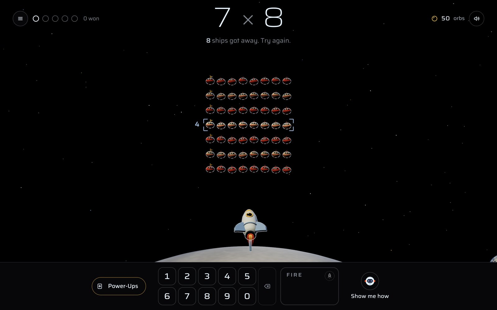
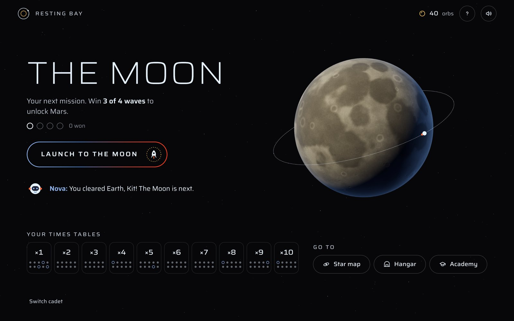
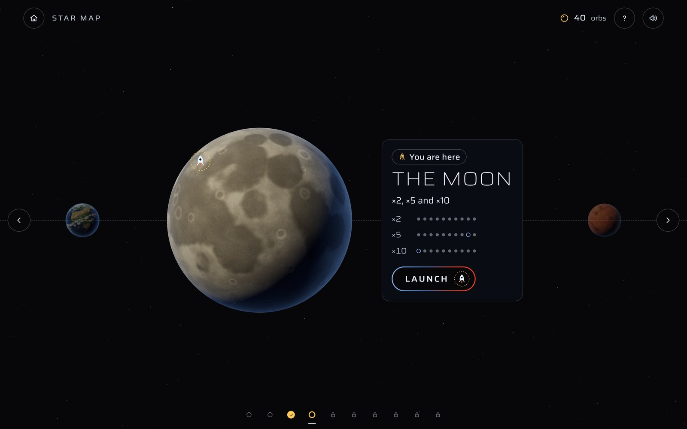
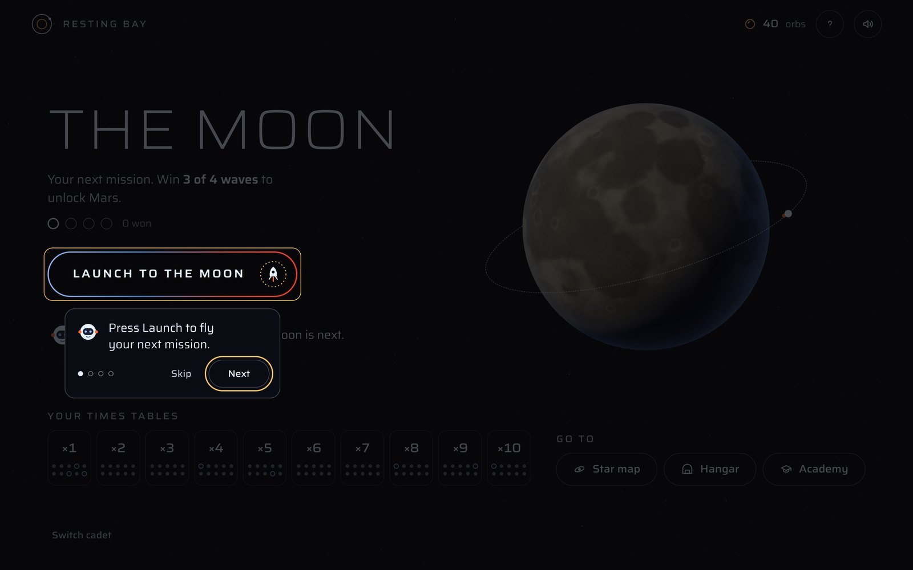
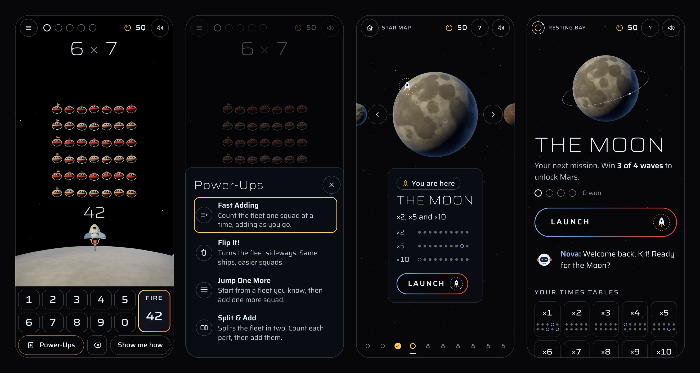

<p align="center">
  
</p>

# Math World

A space multiplication game where the answer is the action. A fleet flies in as `a` squads of `b` ships, drawn as a true array. You type how many ships there are and fire exactly that many plasma balls. Fire too few and the ships that are left fly on; fire too many and the extras fly past. The game levels itself from `0 × 0` up to multi-digit fleets, and every miss shows the child what to look at next.

It is for children from Grade 3 up, and for adults who do not want to be talked down to.

**Play it:** https://mathworld-theta.vercel.app

<p align="center">
  
</p>
<p align="center"><sub>Six squads of seven. The number you type is the number of plasma balls, on the rocket and on the Fire button.</sub></p>

<table>
  <tr>
    <td width="50%"><br><sub>Fire, and exactly that many plasma balls fly, squad by squad.</sub></td>
    <td width="50%"><br><sub>After a miss the game counts the squads with you, one at a time.</sub></td>
  </tr>
  <tr>
    <td width="50%"><br><sub>The Resting Bay: the next mission, and the times tables filling in.</sub></td>
    <td width="50%"><br><sub>The Star map, one planet at a time.</sub></td>
  </tr>
  <tr>
    <td width="50%"><br><sub>A first visit walks through each screen, one control at a time.</sub></td>
    <td width="50%"><br><sub>The Hangar: orbs earned by learning buy looks for the rocket.</sub></td>
  </tr>
</table>

<table>
  <tr>
    <td width="33%"><br><sub>The opening film starts on an ordinary Tuesday.</sub></td>
    <td width="33%"><br><sub>The cadet meets Nova, the co-pilot.</sub></td>
    <td width="33%"><br><sub>And it ends with a launch.</sub></td>
  </tr>
</table>

<p align="center">
  
</p>
<p align="center"><sub>On a phone: the battle, the Power-Ups list, the Star map and the Resting Bay.</sub></p>

## What was asked, and where to find it

- **A game that levels itself, from single digits up to multi-digit.** Mastery is tracked for each fact, and the next fleet is chosen from it. Eight missions run from times 0 and times 1 on Earth to multi-digit fleets in Deep Space. A bot harness plays five kinds of learner through the real code and checks where each ends up: [`docs/levelling-proof.md`](docs/levelling-proof.md).
- **A visual and spoken "Show me how".** After a miss the game counts the squads with you, one at a time. "Show me how" walks a named trick over the fleet in front of you, out loud, and is shorter the second time.
- **Progress saved to a database.** Every answer is appended to an event log in Postgres. Mastery, orbs and unlocks are all worked out from that log.
- **Next.js and TypeScript.** Next.js 16, TypeScript, three.js for the battle and the film, Drizzle on Postgres, and more than 400 tests.

## Try it in five minutes

1. Sign up, then watch the film (under two minutes) or skip it, and take the guided first shot.
2. On the Moon, miss on purpose, twice. The first miss counts the squads. The second counts the ships in a squad and offers a Power-Up. Then tap **Show me how**.
3. Open `/play/jupiter?dev&a=12&b=14` for a multi-digit fleet.
4. Open `/admin` for mastery by fact and the transfer rate (it needs `MW_ADMIN_KEY`).

More shortcuts: `/?dev` lists every planet and screen, **Shift+D** in a battle opens live telemetry, and `/kit` is the design system.

## How it teaches

- **The answer is the action.** There is no answer box and no multiple choice. The number you type is the number of plasma balls.
- **A miss shows itself.** Ships left over fly on, or extra balls fly past, with their counts.
- **Structure is found, not printed.** Nothing is drawn on the fleet until you have answered. Hints come one step at a time, after a miss.
- **Tricks become tools.** A trick you have watched becomes a Power-Up that rearranges the fleet without giving the answer.
- **No punishment.** No timers, no streaks to lose, and orbs are earned only by learning.

## How it is built

- **Event-sourced.** One append-only log of what the player did; all state is folded from it, and the database refuses to edit or delete a row.
- **Code owns the maths.** Every split and answer comes from pure TypeScript and is checked by tests. Nothing is generated at runtime.
- **Saves survive a bad connection.** Answers queue and retry, and a retried save is stored once.
- **3D where it counts.** The battle and the film are 3D. Every other screen is 2D, in one design system.
- **Built with Claude Code.** The brief for each round is [`OVERHAUL.md`](OVERHAUL.md), and the handoff note from every track is in [`docs/overhaul/`](docs/overhaul/).

The layers, the levelling numbers, telemetry and deployment are in [`docs/architecture.md`](docs/architecture.md).

## Run it

```bash
bun install
bun run dev      # http://localhost:3200
bun run check    # types, lint and tests
bun run build    # production build
```

Locally the database is PGlite in `.data/pg`, created on first use. Set `DATABASE_URL` to use Postgres. To deploy on Vercel with Supabase, see [`docs/architecture.md`](docs/architecture.md#deploy-vercel-and-supabase).
